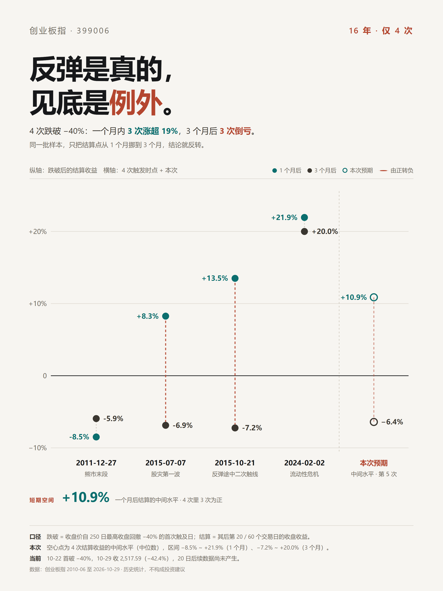

# 创业板指 4 次跌破 −40% 之后

> 把"跌多了会不会反弹"改造成一个**可证伪、可复现**的概率问题。
> A pre-registered event study on ChiNext Index (399006): what actually happens after a −40% drawdown.



---

## 一句话结论

**反弹是真的，见底是例外。**

2010–2026 年，创业板指有 4 次收盘跌破"自 250 日高点回撤 −40%"：其中 3 次在一个月内涨超 19%，但 3 个月后仍有 3 次是亏的。当前是第 5 次触发：2026-10-22 首次收盘跌破，至 10-30 收 2,413.63，回撤 −44.8%。

---

## 结论表

| 口径 | 结果 | 说明 |
|---|---|---|
| 1 个月内最大涨幅 | 4 次中 3 次 **> +19%** | 反弹确实会来 |
| 1 个月后结算 | 中间水平 **+10.9%**，3/4 为正 | 按触发日收盘买入计 |
| 3 个月后结算 | 中间水平 **−6.4%**，3/4 为负 | 反弹多数被回吐 |
| 20 日内破前低 | 4 次中 1 次 | 即 2011-12，先跌 14.1% |
| 无条件基准率 P(20日≥5%) | **42.2%** | 全样本 3,964 个起点 |
| 条件概率（C1，收缩后） | **49.1%**（90% 区间 30.7–67.6%） | 样本仅 4 个 |
| 完全匹配当前状态（C5） | **16 年 0 次先例** | 连跌≥5 周 且 60 日跌幅≤−25% |

**这张表最重要的不是 49%，而是两个数字的对比**：条件概率的 90% 区间 30.7–67.6% **完整覆盖**了无条件基准率 42.2%。也就是说，以现有样本量，无法证明"跌多了"比"什么都不知道"更有用。

---

## 方法

### 1. 事件定义（预注册）

见 [`docs/预注册清单_2026-10-30.md`](docs/预注册清单_2026-10-30.md)。所有参数在看结果之前锁定，事后不可修改。

```
P(H, Y) = P( 存在 h ∈ (0, H]，使 max(close[t0+1..t0+h]) / close[t0] − 1 ≥ Y )
```

主口径 **H=20 交易日 / Y=5%**，敏感性：20/3%、20/10%、60/10%。只用收盘价，不用盘中最高价。

### 2. 条件集（5 个）

| 编号 | 条件 |
|---|---|
| C1 | 自 250 日最高收盘回撤 ≤ −40%，首次触及 |
| C2 | 连跌 ≥4 完整周 且 60 日跌幅 ≤ −20% |
| C3 | 60 日跌幅 ≤ −25% |
| C4 | 连跌 ≥3 周 且 60 日跌幅 ≤ −12% |
| C5 | 连跌 ≥5 周 且 60 日跌幅 ≤ −25% |

事件间强制 **60 交易日冷却期**，防止同一段下跌被重复计数。

### 3. 统计处理

- **Wilson 95% 置信区间**：原始命中率
- **贝叶斯收缩**：先验 Beta 以基准率为均值、强度 n₀=15 个伪观测。这一步把 C2 的 3/3=100% 拉回 51.8%，也把 n=1 的荒谬估计压回基准率附近
- **形态同构**：摆动点规则（跌 30% 触发、反弹 20% 结束）切出 9 段熊市，比较深度 / 历时 / 波动率 / 量能
- **不做**：特征筛选、模型调参、样本外择优

---

## 复现

依赖：Python 3.10+，`pip install -r requirements.txt`

```bash
# 1. 拉取行情（腾讯 + 新浪双源互证）
python scripts/fetch_399006.py

# 2. 核心分析：基准率 / 条件概率 / 形态同构
python scripts/analyze.py

# 3. 生成报告与导出
python scripts/build_report_html.py     # 单文件 HTML 报告
python scripts/build_plan_html.py       # 方案文档
python scripts/export_outputs.py        # 概率矩阵 CSV + DOCX 备份

# 4. 分享图（需要 Edge/Chrome headless 截图）
python scripts/build_share_card.py
```

辅助脚本：`recon.py`（跌幅与样本量侦察）、`check_drawdowns.py`（回撤排名核对）、
`diagnose_c5.py`（C5 无先例的边界诊断）、`near_neighbors.py`（最近邻时点前瞻）。

---

## 目录

```
data/    399006_daily_tencent.csv（3,984 个交易日）、analysis_result.json（全部中间结果）
scripts/ 取数、分析、出图、导出，全部可复现
out/     报告 HTML、概率矩阵 CSV、分享图 PNG、DOCX 备份
docs/    预注册清单
```

---

## 已知局限（重要）

1. **样本量是硬伤。** C1 只有 4 个样本，其中 2 个（2015-07、2015-10）来自同一轮崩盘，独立事件实际只有 3 个。任何区间的宽度都受此限制。
2. **1 个月的中位数不稳。** 去掉 2024-02 那次，1 个月中间水平从 +10.9% 降到 +8.3%；3 个月几乎不动（−6.4% → −6.9%）。所以**"3 个月会亏回去"比"1 个月 +10.9%"更硬**。
3. **同构性只做了价格形态**，不含宏观驱动、流动性、估值分位。而这恰恰是决定后续分布的关键。
4. **多重比较未矫正。** 5 条件 × 4 网格 = 20 个检验，纯随机也会出现约 1 个"显著"，因此未单独挑出任何显著结果。
5. **不含分红、费用、冲击成本。** 指数收益与实际持仓收益之间有摩擦。

---

## 数据来源与版权

- 行情：腾讯财经 `web.ifzq.gtimg.cn`，经新浪财经 1,023 个重叠交易日交叉校验，收盘价差异 >0.05 元的天数为 **0**
- 两融与市场总貌：深圳证券交易所官方接口
- 东方财富 `push2his` 接口在开发机上被拒绝连接，未采用

行情数据版权归原始数据源所有，本仓库仅用于研究与复现，不作商业分发。

---

## 更新记录

| 日期 | 变更 |
|---|---|
| 2026-11-02 | 行情延长至 2026-10-30（3,984 个交易日）。收盘 2,413.63，单日 **−4.13%**，累计回撤 **−44.79%**，确认为 **6 个完整下跌周**（−28.44%）。**统计结论未变**：基准率 42.2%、C1 收缩后 49.1%、4 个类比样本、9 段熊市。顺带统一百分比负号（U+2212），并把图表里的样本量改为动态取值。 |
| 2026-10-30 | 首次发布。数据截至 2026-10-29（3,983 个交易日）。`docs/预注册清单` 与方案文档冻结为当日快照，不再随行情更新。 |

> 口径声明：上表"统计结论未变"指**参数与结论均未调整**，仅延长样本。若未来出现结论反转，只会在本表追加记录，不会修改历史条目。

---

## 免责声明

本项目为**历史数据统计**，不构成任何投资建议，不预测未来走势，不提供买卖建议。
作者不具备证券投资咨询业务资格。历史规律不保证重现，极端行情下统计方法可能整体失效。
详见 [DISCLAIMER.md](DISCLAIMER.md)。

## License

MIT（代码与文档）。数据版权见上。
